<div align="center">

# 一路相伴

**把政府服務照人生事件排好，讓「用不了」的人也能一步一步辦完**

台北通（Town Pass）微服務 · 2026 臺北秋季程式設計節參賽作品

[正式網址](https://townpass-life-events.pages.dev/) · [計畫書](docs/story-plan.md) · [城市嚮導規劃](docs/ai-city-guide.md) · [微服務技術文件](microservice/README.md)

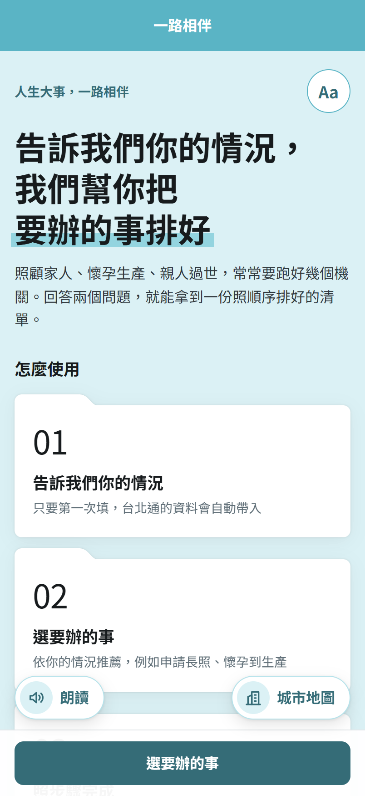 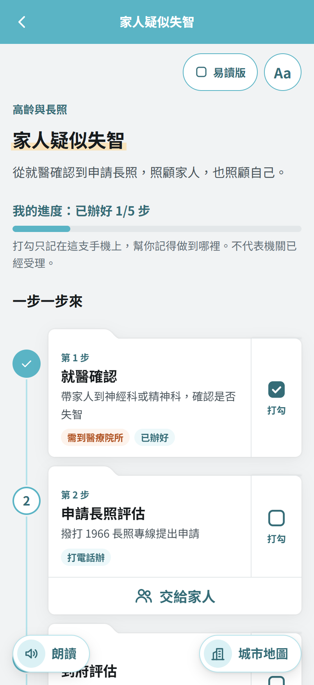 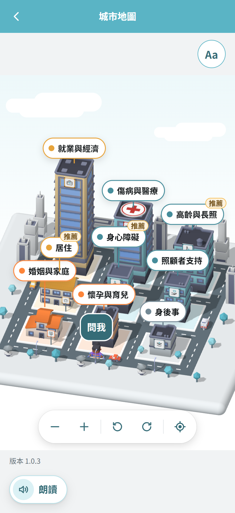

</div>

## 目錄

- [為什麼做這個](#為什麼做這個)
- [功能展示](#功能展示)
- [畫面截圖](#畫面截圖)
- [使用流程](#使用流程)
- [系統架構](#系統架構)
- [技術](#技術)
- [專案結構](#專案結構)
- [快速開始](#快速開始)
- [資料來源](#資料來源)
- [AI 使用揭露](#ai-使用揭露)
- [隱私與安全](#隱私與安全)
- [無障礙](#無障礙)
- [第三方套件與授權](#第三方套件與授權)
- [已知限制](#已知限制)
- [關於 Town Pass](#關於-town-pass)

## 為什麼做這個

政府提供的資源並不少，但需要的人常常「用不了」。家人突然住院、自己拿到身障鑑定通知、親人過世，往往正是最沒有力氣自己去找的時候。

| 用不了的原因 | 市民的心聲 | 這個服務怎麼做 |
| --- | --- | --- |
| 不知道有 | 「原來我可以申請這個補助？」 | 依你的情況推薦可能用得到的事和資源 |
| 看不懂 | 「公文用語我看不懂。」 | 每一步用白話寫要做什麼、帶什麼，另有易讀版 |
| 找不到 | 「資訊散在好幾個機關的網站。」 | 一件事的步驟、資源、台北通服務集中在同一頁 |
| 走不到 | 「行動不便，跑錯櫃檯很辛苦。」 | 標示能不能線上辦；要臨櫃時用 AR 指出方向 |
| 不會用 | 「手機字太小、按鈕太多。」 | 字級最大 200%、高對比、朗讀，讀屏都能操作 |
| 來不及 | 「家人突然住院，我不知道從哪裡開始。」 | 以人生事件為入口，照順序列出待辦步驟 |

主要服務對象是身心障礙者、高齡者、孕婦、傷病者與照顧者。目前收錄 9 類、37 件人生大事，其中 20 件已整理出完整的 95 個步驟，其餘 17 件標示「建置中」，可先撥打 1999。

## 功能展示

以下 GIF 都是在電腦的 Chrome 以手機尺寸錄製的瀏覽器預覽。台北通 App 的能力（藍牙、相機、定位、裝置端 AI）在瀏覽器中以模擬資料代替，畫面上會標示「瀏覽器預覽」或「示範資料」。

<table>
<tr>
<td width="50%" valign="top">

### 3D 城市地圖

九類人生大事各是一棟大樓，依主題分成家庭、照顧與健康、工作與居住、身後事四色。點一棟大樓，底部滑出這一類要辦的事與進度。可以拖曳、捏合縮放、轉動，也能用下方按鈕操作，不會雙指操作的人也能用。

</td>
<td width="50%" valign="top">

### 城市嚮導（裝置端 AI）

在地圖上點「問我」，用白話問問題，例如「爸爸中風快出院了，我要申請什麼？」。手機上的模型選出相關的服務，嚮導小人沿著馬路走到對應的大樓，一站一站帶著看。推論全部在手機上進行，不呼叫雲端 API。

</td>
</tr>
<tr>
<td align="center">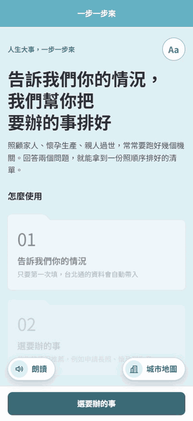</td>
<td align="center">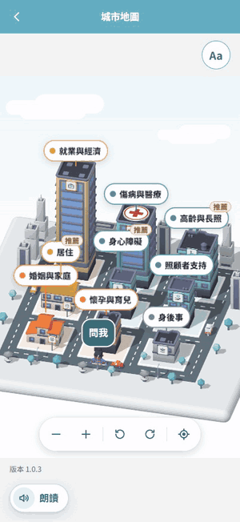</td>
</tr>
<tr>
<td width="50%" valign="top">

### AR 方向指引

要到區公所、戶政事務所或聯醫院區臨櫃辦理時，打開相機，大箭頭指向目的地並顯示直線距離。對準時箭頭變綠、寫「就在前方」。方向同時寫成句子讓讀屏念出；沒有相機或指南針時改用錶盤或東南西北說法。

</td>
<td width="50%" valign="top">

### 字級、對比與易讀版

每一頁右上角的「Aa」都能調字級（100% 到 200%）、高對比與易讀版，畫面上的範例馬上跟著變。易讀版把「要做什麼」改成照順序編號的短句。

</td>
</tr>
<tr>
<td align="center">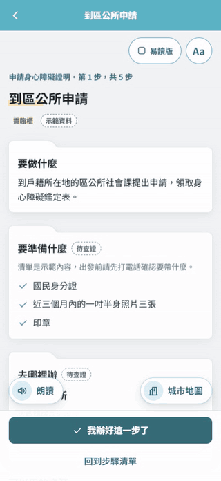<br><sub>電腦瀏覽器模擬：街景是假的相機畫面，方位由程式合成</sub></td>
<td align="center">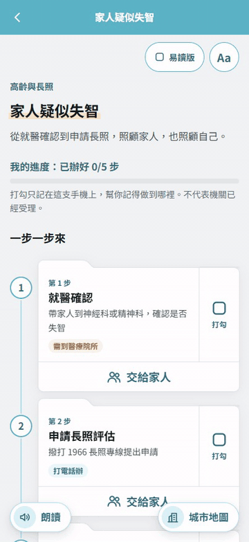</td>
</tr>
</table>

### 藍牙交棒給家人

長輩做不到的步驟（例如要臨櫃），在步驟清單按「交給家人」。兩支手機靠近，用藍牙把這件事交給家人，雙方核對同一組 4 位數代碼。之後家人打勾「已辦好」，長輩的手機也會跟著打勾。藍牙只傳一張約 200 bytes 的交棒票，個人資料不經過藍牙。

<p align="center">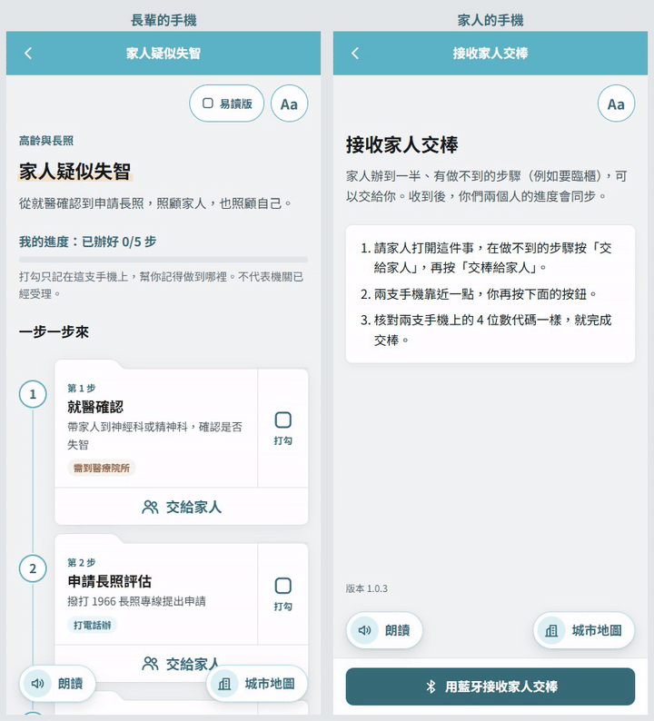</p>

## 畫面截圖

<table>
<tr>
<td align="center" width="25%"><br><b>首頁</b><br><sub>兩個問題，拿到排好的清單</sub></td>
<td align="center" width="25%">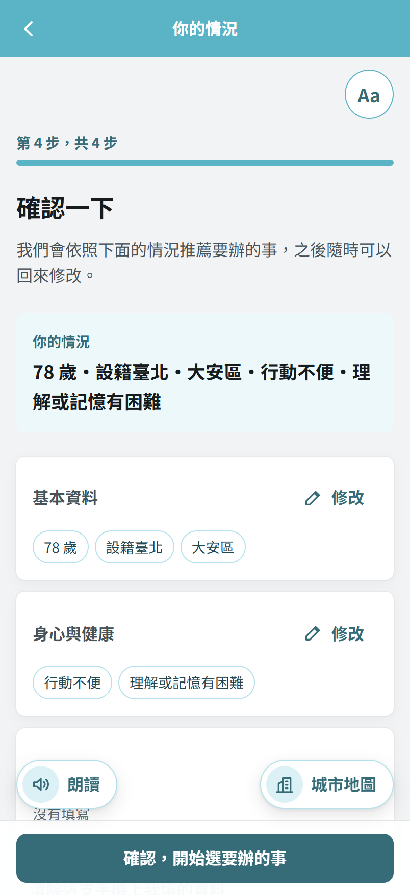<br><b>你的情況</b><br><sub>台北通帳號資料自動帶入</sub></td>
<td align="center" width="25%">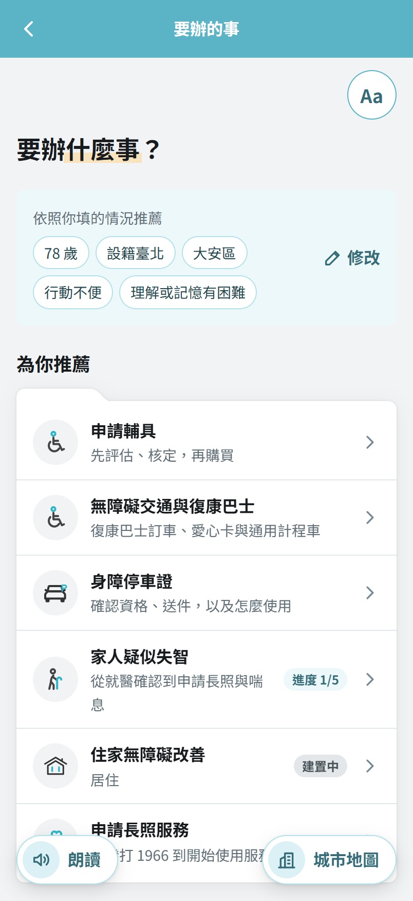<br><b>要辦的事</b><br><sub>依情況推薦，其他依類別收合</sub></td>
<td align="center" width="25%"><br><b>步驟清單</b><br><sub>打勾記進度，做不到的交給家人</sub></td>
</tr>
<tr>
<td align="center">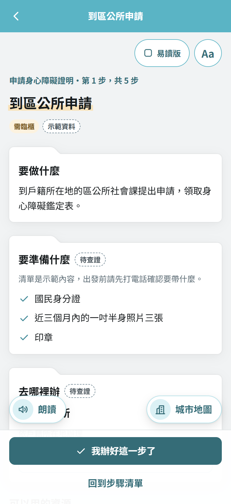<br><b>步驟詳情</b><br><sub>要做什麼、帶什麼、去哪裡辦</sub></td>
<td align="center">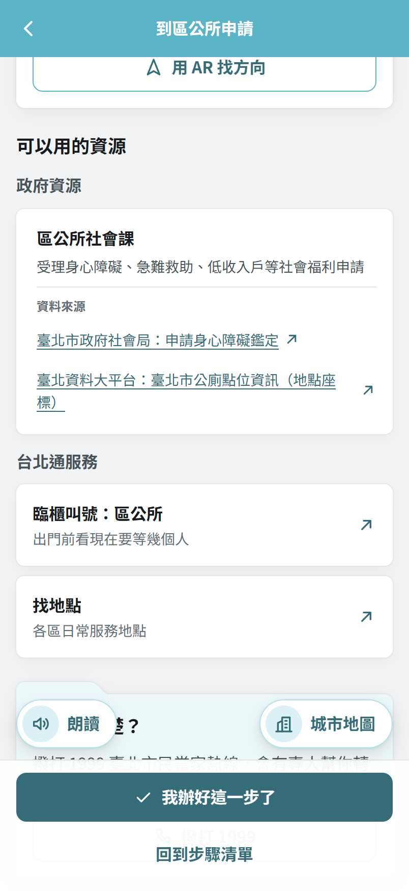<br><b>可以用的資源</b><br><sub>每張卡片附資料來源，直接開台北通服務</sub></td>
<td align="center">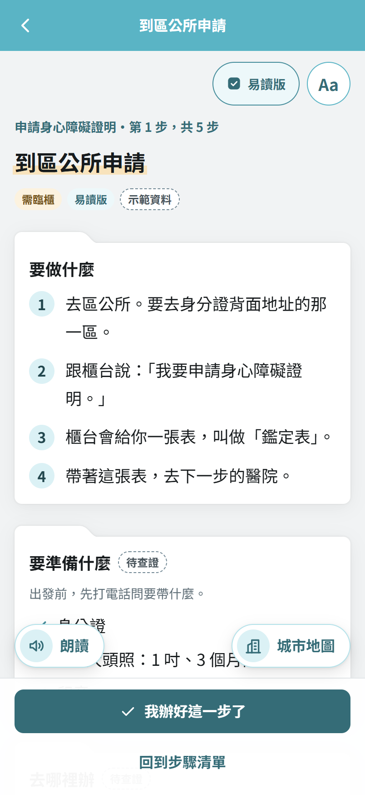<br><b>易讀版</b><br><sub>照順序編號的短句</sub></td>
<td align="center">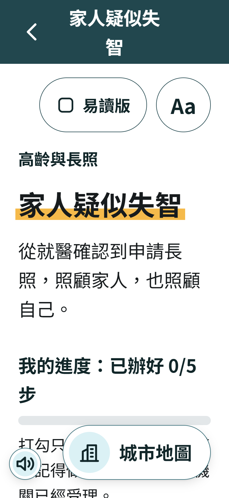<br><b>200% 字級＋高對比</b><br><sub>版面全用 rem，不橫向捲動</sub></td>
</tr>
<tr>
<td align="center"><br><b>城市地圖</b><br><sub>標籤是真正的按鈕，讀屏可操作</sub></td>
<td align="center">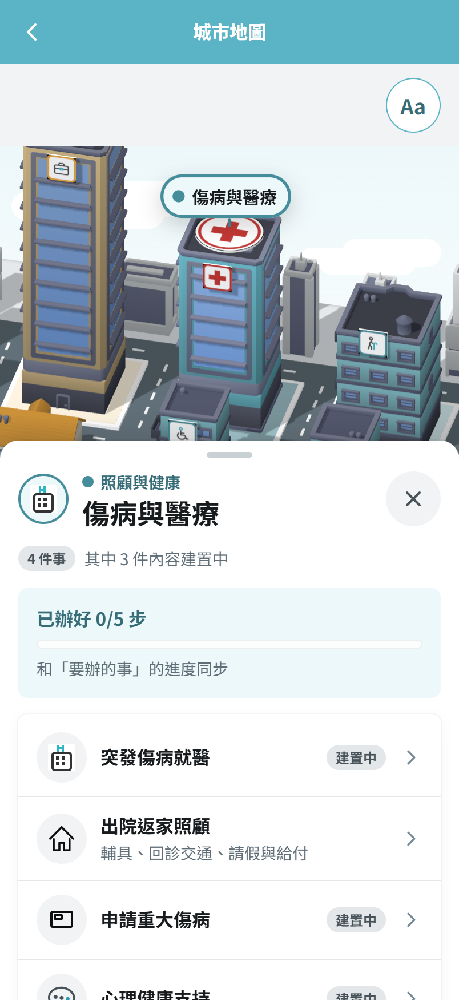<br><b>大樓抽屜</b><br><sub>這一類的事與進度</sub></td>
<td align="center">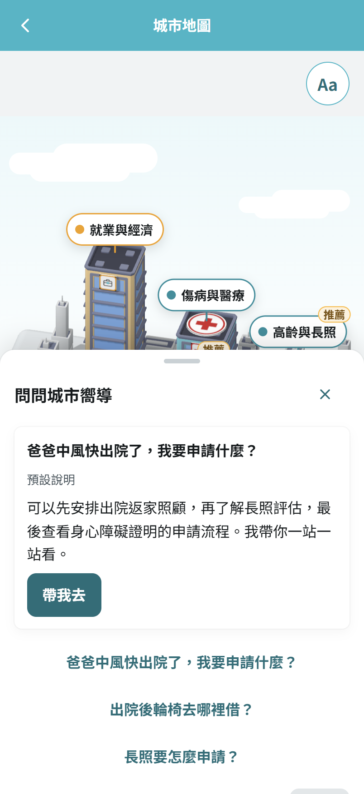<br><b>城市嚮導</b><br><sub>沒有模型時用預設說明</sub></td>
<td align="center">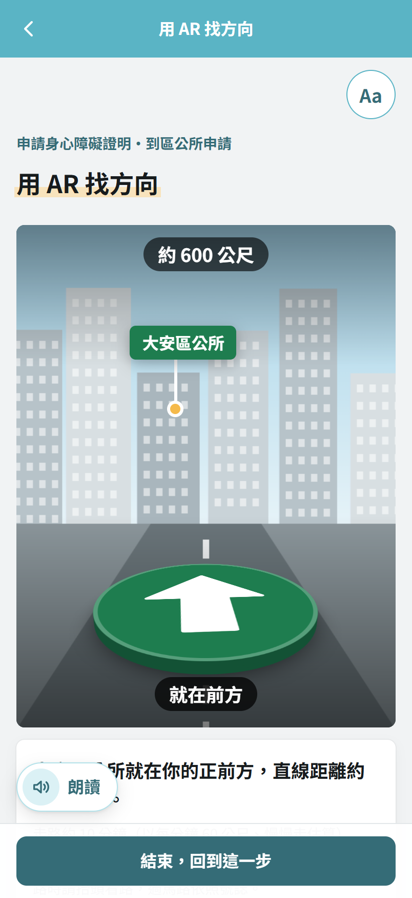<br><b>AR 方向指引</b><br><sub>對準後箭頭變綠（瀏覽器模擬）</sub></td>
</tr>
<tr>
<td align="center">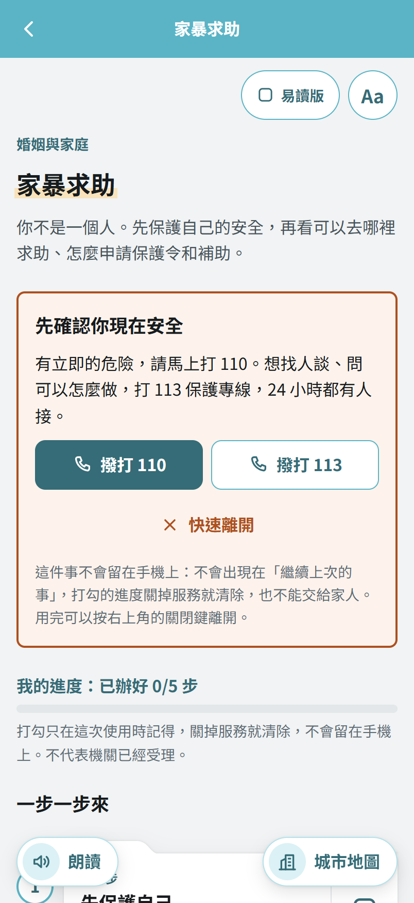<br><b>家暴求助</b><br><sub>不留紀錄，固定有 110、113 與快速離開</sub></td>
<td align="center">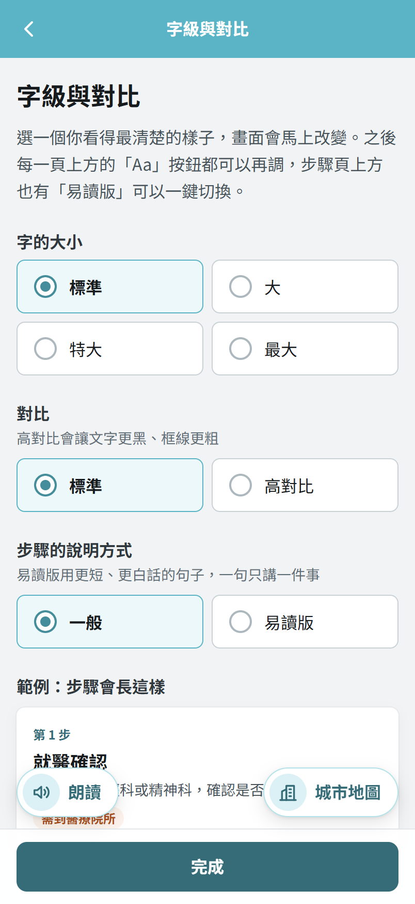<br><b>字級與對比</b><br><sub>第一次使用先調成好讀的樣子</sub></td>
<td></td>
<td></td>
</tr>
</table>

## 使用流程

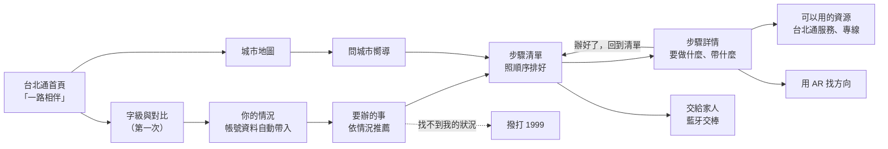

## 系統架構

作品主體是在台北通 WebView 裡開啟的微服務網頁（Vue 3），部署在 Cloudflare Pages。藍牙、定位、撥號、裝置端 AI 這些手機能力由台北通 App（Flutter）提供，網頁透過 `window.flutterObject.postMessage` 呼叫。只有「交棒給家人」需要後端，用 Flask 讓兩支手機同步進度。

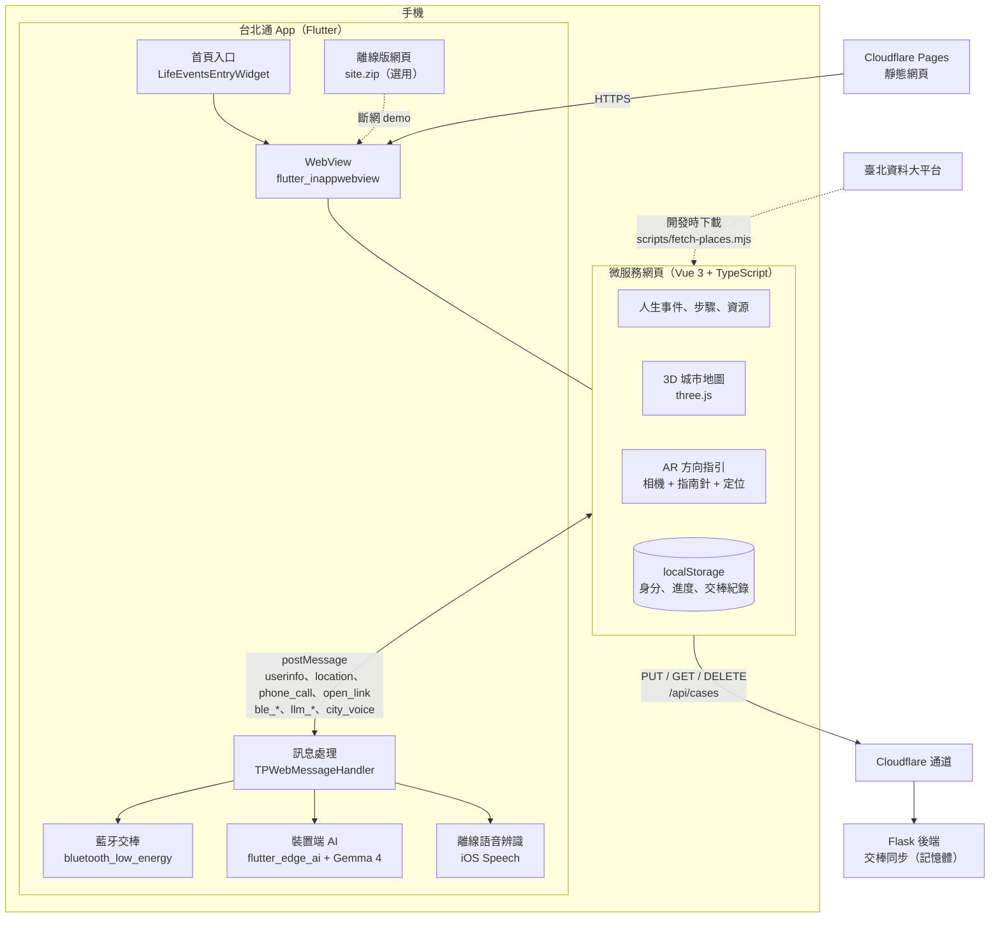

### 與台北通 App 的溝通

| 訊息 | 用途 |
| --- | --- |
| `userinfo` | 第一次填「你的情況」時，帶入年齡、是否設籍臺北、居住行政區 |
| `location` | AR 方向指引取得目前位置 |
| `phone_call` | 撥打 1999、1966、110、113 等專線 |
| `open_link` | 開啟台北通內的其他服務（直接開到某個櫃檯或表單）與資料來源網頁 |
| `ble_handover_share_start`、`ble_receive`、`ble_share_stop` | 藍牙傳送與接收交棒票 |
| `llm_status`、`llm_ask`、`llm_cancel` | 城市嚮導的裝置端 AI 問答 |
| `city_voice`、`city_voice_cancel` | 城市嚮導的離線語音輸入（iPhone） |

### 交棒同步

藍牙只傳交棒票：案件編號、存取權杖、預留的加密金鑰。後端只存權杖的雜湊值，內容只有事件、遮蔽中間字的姓名（例如「金○森」）和每一步的打勾狀態。沒有資料庫，案件放在 Flask 的記憶體；寫入用版本號避免互相覆蓋，衝突時下載最新版逐步合併，以最後一次修改為準。

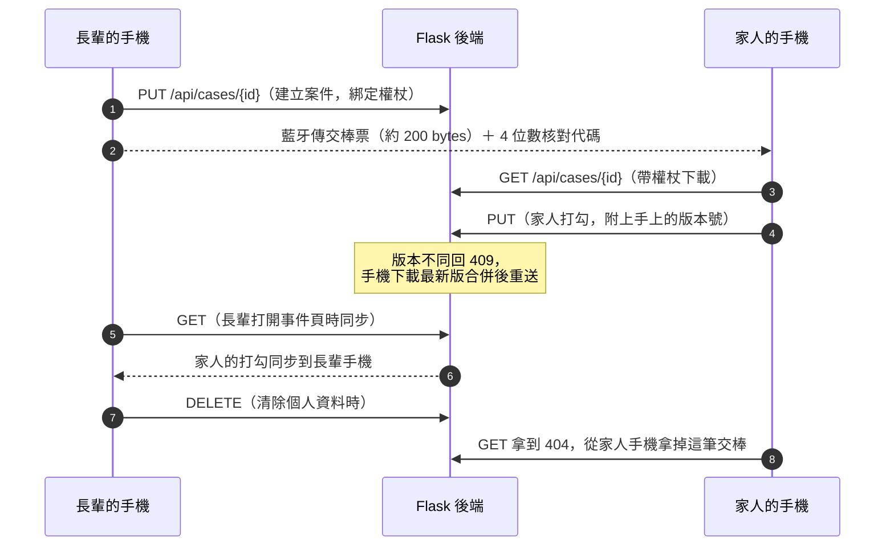

## 技術

| 層 | 技術 |
| --- | --- |
| 微服務前端 | Vue 3.5、vue-router 4.6（hash 路由）、Vite 7.3、TypeScript 5.9 |
| 3D 城市地圖 | three.js 0.187（正交鏡頭、只在畫面變化時重畫、獨立打包，打開地圖才下載） |
| AR 方向指引 | getUserMedia 相機、DeviceOrientation 指南針（iPhone `webkitCompassHeading`、Android `deviceorientationabsolute`）、定位 |
| 朗讀 | Web Speech API（手機系統的語音引擎，不經過雲端） |
| 台北通 App | Flutter 3.47.6（fvm）、GetX、flutter_inappwebview |
| 藍牙 | bluetooth_low_energy 6.2（GATT 廣播與讀取） |
| 裝置端 AI | flutter_edge_ai 2.5.6、flutter_edge_ai_litertlm 1.19.2、Gemma 4 E2B IT |
| 後端 | Flask（Python）、gunicorn、Docker |
| 部署 | Cloudflare Pages（wrangler）、cloudflared 快速通道 |
| 品質檢查 | 開發時以 Playwright（Chrome）跑操作流程，以 axe-core 檢查 WCAG 2.2 A／AA |

## 專案結構

```text
.
├── microservice/          # 微服務網頁（作品主體）
│   ├── src/
│   │   ├── views/         # 各頁：首頁、你的情況、要辦的事、步驟、AR、交棒、城市地圖
│   │   ├── components/    # 共用元件：版面、朗讀按鈕、底部抽屜、城市嚮導
│   │   ├── city/          # 3D 城市地圖：配置、場景、貼圖、嚮導站點
│   │   ├── stores/        # 身分、進度、顯示設定、交棒紀錄（localStorage）
│   │   ├── services/      # 台北通 App 溝通、交棒 API、相機、指南針、朗讀
│   │   └── data/          # 人生事件與步驟、資源來源、AR 地點（開放資料）
│   ├── public/city/       # Kenney 3D 模型（CC0）
│   └── scripts/           # 部署、下載開放資料、打包離線版
├── backend/               # Flask：交棒同步 API
├── lib/                   # 台北通 App（Flutter），本作品新增：
│   ├── page/home/widget/life_events/          # 首頁入口
│   ├── service/ble_share_service.dart         # 藍牙交棒
│   ├── service/city_guide_*.dart              # 裝置端 AI、離線版網頁
│   └── util/web_message_handler/              # 網頁訊息處理
├── ios/Runner/AppDelegate.swift               # iPhone 離線語音辨識
└── docs/                  # 計畫書、城市嚮導規劃、README 圖片
```

## 快速開始

### 在電腦上看微服務

需要 Node.js 20.19 以上或 22.12 以上。

```bash
cd microservice
npm install
npm run dev        # http://localhost:5173
```

在一般瀏覽器開啟時沒有台北通 App，會用模擬資料並在上方顯示模擬的標題列。用 Chrome DevTools 的裝置模擬（例如寬 402px）檢查手機版面。也可以直接用手機開 [正式網址](https://townpass-life-events.pages.dev/)。

### 交棒同步的後端

```bash
cd backend
ALLOWED_ORIGINS=https://townpass-life-events.pages.dev,http://127.0.0.1:43862 \
  uv run --with "flask>=2.2,<4" flask --app app run --host 127.0.0.1 --port 5000
cloudflared tunnel --no-autoupdate --url http://localhost:5000   # 記下印出的 https://xxxx.trycloudflare.com
```

建置微服務時用 `VITE_API_BASE` 帶入通道網址，或寫在 `microservice/.env.production.local`。詳見 [微服務技術文件](microservice/README.md#部署cloudflare-pages)。

### 部署微服務

```bash
cd microservice
npm run deploy:login   # 第一次：瀏覽器登入 Cloudflare
npm run deploy         # 型別檢查、打包、上傳到 Cloudflare Pages
```

### 建置台北通 App

需要 [Flutter](https://docs.flutter.dev/get-started/install)（以 [FVM](https://fvm.app/documentation/getting-started/installation) 指定 3.47.6）、Xcode（iOS）或 Android SDK。

```bash
fvm flutter pub get
fvm dart run build_runner build
fvm flutter run
```

台北通首頁的「一路相伴」預設開正式網址，網頁改版只要部署，App 不用重新建置。開發時要改開自己的網址：`fvm flutter run --dart-define=LIFE_EVENTS_URL=https://xxxx.trycloudflare.com/`。

### 離線版（斷網 demo，選用）

要在沒有網路的場合展示時，把網頁與 3D 素材打包進 App，並在建置時指定使用離線版：

```bash
cd microservice
npm ci
VITE_API_BASE=https://xxxx.trycloudflare.com npm run build:app
cd ..
fvm flutter run --dart-define=LIFE_EVENTS_BUNDLED=true
```

沒有加 `LIFE_EVENTS_BUNDLED=true` 時，就算 App 裡有打包好的 `site.zip` 也不會使用。

## 資料來源

- **AR 地點**：[臺北市公廁點位資訊](https://data.taipei/dataset/detail?id=ca205b54-a06f-4d84-894c-d6ab5079ce79)、[臺北市各區戶政事務所等候人數](https://data.taipei/dataset/detail?id=3b9856c9-d26b-4089-95ad-bc4c5908461e)，來自臺北資料大平台，政府資料開放授權條款－第1版。整理成 11 個區公所、11 個戶政事務所、7 個聯醫院區（`microservice/src/data/places.json`），開發時下載，執行時不連線。
- **步驟與資源**：婚姻與家庭、身心障礙、就業與經濟三類 14 件事，依內政部戶政司、司法院、衛福部、臺北市社會局、就業服務處、勞動力重建運用處、公共運輸處等官方公開資料整理，各檔開頭列出來源機關與查詢日期。其餘事件仍是劇情草稿，畫面上一律標示「示範內容」。
- **資料出處標在每張資源卡片上**：步驟頁「可以用的資源」的每一張卡片下方都有「資料來源」，點了用台北通開官方網頁，網址集中在 `microservice/src/data/sources.ts`。
- **台北通服務**：對應 TownPass 的 `my_service_model.dart`，網址為空的服務在 App 中也尚未開放，畫面會標示「尚未開放」。
- **3D 模型**：Kenney 的 [City Kit Commercial](https://kenney.nl/assets/city-kit-commercial)、[City Kit Suburban](https://kenney.nl/assets/city-kit-suburban)、[Car Kit](https://kenney.nl/assets/car-kit)、[City Kit Roads](https://kenney.nl/assets/city-kit-roads)、[Mini Characters](https://kenney.nl/assets/mini-characters)，授權皆為 CC0。
- **圖示**：`icon_*.svg` 取自 TownPass 的 `assets/svg/`（城市通 Figma UI Kit）；UI Kit 沒有的概念依同一規格自行繪製。

## AI 使用揭露

### 執行時：城市嚮導的裝置端 AI

App 執行時不呼叫任何雲端 LLM API，推論全部在手機上完成。模型只負責從本機的服務資料中「選出」相關的站點與步驟，地點、電話、補助名稱一律來自本機資料，不讓模型自行生成，避免捏造政府資訊。

| 項目 | 內容 |
| --- | --- |
| 模型 | Google Gemma 4 E2B IT（LiteRT Community 發布的 LiteRT-LM 格式） |
| 量化 | `gemma-4-E2B-it.litertlm`，混合 2、4、8 位元量化，約 2.59 GB |
| 推論框架 | flutter_edge_ai 2.5.6、flutter_edge_ai_litertlm 1.19.2（MIT） |
| 模型授權 | Apache-2.0 |
| 來源 | [Gemma 4 E2B IT 模型卡](https://huggingface.co/litert-community/gemma-4-E2B-it-litert-lm) |

模型檔另存於 App 私有空間，iPhone 實測以 USB 放進 App 資料容器的 `Library/Application Support/gemma-models/`。沒有可用模型時，城市嚮導改用建議問題與「預設說明」，三站導覽照常可用。規劃與驗收見 [docs/ai-city-guide.md](docs/ai-city-guide.md)。

### 開發時

開發過程使用 AI 程式助理（Claude）協助撰寫程式碼，以及依官方公開資料起草步驟說明與易讀版文字。這些文字是固定寫在程式裡的內容，執行時不呼叫 AI；畫面仍標示「示範內容」，需要團隊逐條核對。

## 隱私與安全

- 身分與進度只存在手機的 localStorage，網頁伺服器（Cloudflare Pages）只放靜態檔，收不到個人資料。
- 交棒只上傳事件、遮蔽中間字的姓名與打勾狀態；後端只存權杖的雜湊值，沒有正確權杖讀不到也改不了。
- 在「你的情況」清除資料時，兩支手機上的交棒紀錄一併刪除：伺服器上的案件先刪掉，對方下次同步拿到 404 就從手機上拿掉。
- AR 的相機畫面只顯示在手機上，不錄影、不上傳、不做影像辨識；位置只用來算方向與距離，不儲存。
- 「家暴求助」是隱私事件：同住的家人可能就是加害人，所以不記住上次打開、打勾不存進手機、不能交給家人，頁面上方固定有 110、113 和「快速離開」。

## 無障礙

- **字級**：標準、大、特大、最大四段（100% 到 200%），版面全用 rem，放大不橫向捲動。
- **高對比**：只換文字、框線、圖示的色票；手機開了「增加對比」時第一次打開自動套用。
- **易讀版**：步驟改成照順序編號的短句，準備清單與地點改用白話寫法。
- **朗讀**：每一頁的「朗讀」按鈕依畫面順序一段一段念，念到哪一段就框起來（目前支援 iPhone）。
- **讀屏**：換頁後焦點移到新頁面的大標題；城市地圖的大樓標籤、地圖操作都是真正的按鈕；AR 的方向變化由讀屏主動念出。
- **手勢替代**：城市地圖的縮放與旋轉都有按鈕可用（WCAG 2.5.1）。
- **減少動態效果**：開啟時不播放大樓長出來與鏡頭移動的動畫。
- **檢查方式**：開發時用 axe-core 掃過每一頁的 WCAG 2.2 A／AA 規則，標準與高對比都檢查；並檢查 375、402、440 寬與最大字級時不會橫向捲動。實機的 VoiceOver 與 TalkBack 仍需人工確認。

## 第三方套件與授權

本作品新增的套件都是開源免費授權：

| 套件 | 版本 | 用途 | 授權 |
| --- | --- | --- | --- |
| vue | 3.5 | 微服務前端 | MIT |
| vue-router | 4.6 | 路由 | MIT |
| vite、@vitejs/plugin-vue | 7.3、6.0 | 打包 | MIT |
| typescript、vue-tsc | 5.9、3.3 | 型別檢查 | Apache-2.0、MIT |
| three | 0.187 | 3D 城市地圖 | MIT |
| wrangler | 4.158 | 部署（不打包進網頁） | MIT 或 Apache-2.0 |
| bluetooth_low_energy | 6.2.1 | 藍牙交棒 | MIT |
| flutter_edge_ai | 2.5.6 | 裝置端 AI | MIT |
| flutter_edge_ai_litertlm | 1.19.2 | LiteRT-LM 推論 | MIT |
| archive | 4.3.0 | 解開離線版網頁 | MIT |
| path_provider | 2.1.6 | 模型與離線版的存放位置 | BSD-3-Clause |
| Flask | 2.2 以上 | 交棒同步後端 | BSD-3-Clause |
| gunicorn | 22 以上 | Docker 裡的正式伺服器 | MIT |

3D 模型與城市嚮導角色取自 Kenney，授權皆為 CC0，授權檔在 `microservice/public/city/`。地圖類功能未使用 Google Maps 或 Mapbox。

## 已知限制

- 交棒案件只存在 Flask 的記憶體，後端重開後要請長輩再交棒一次；快速通道的網址每次重開都會變。
- 交棒內容目前以明文上傳，交棒票裡的金鑰已預留給之後的端對端加密。
- 部分事件的步驟仍是劇情草稿，畫面標示「示範內容」，需要逐條對照官方資料。
- 朗讀目前只支援 iPhone；Android 的 WebView 多半沒有語音，按鈕會自動隱藏。
- Android 上，台北通本身要先有相機權限，AR 才能開相機；還沒有時會改用指南針錶盤。

## 關於 Town Pass

本專案 fork 自臺北市政府資訊局的開源專案 [taipei-doit/TownPass](https://github.com/taipei-doit/TownPass)。Town Pass 是開放的社群專案，希望市民、第三方與各縣市一起參與城市通的發想、開發與改善。更多內容請見 [Town Pass 開發者文件](https://tpe-guideline.web.app/en/docs/)。

授權：[GPL-3.0](LICENSE)，與 TownPass 原專案相同。
