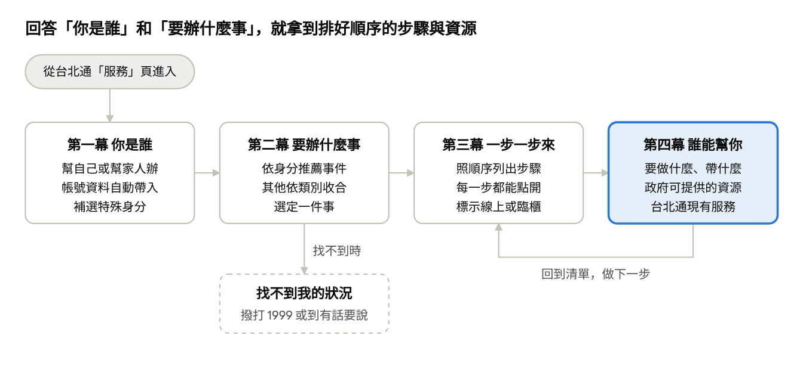

# 「用不了」數位平權微服務計畫書

2026-11-07 · @hwj

## 緣起：為什麼「用不了」

政府提供的資源並不少，但需要的人常常「用不了」：不知道有、看不懂、找不到、走不到、不會用、來不及。本服務不要求市民學會怎麼找政府，而是把政府服務照著市民的人生事件排好，一步一步帶著走。

| 用不了的原因 | 市民的心聲 | 本服務的回應 |
| --- | --- | --- |
| 不知道有 | 「原來我可以申請這個補助？」 | 依身分主動列出可能符合的資源 |
| 看不懂 | 「公文用語我看不懂。」 | 每一步用白話說明要做什麼、要帶什麼 |
| 找不到 | 「資訊散在好幾個機關的網站。」 | 一件事的所有步驟集中在同一個地方 |
| 走不到 | 「行動不便，跑錯櫃檯很辛苦。」 | 事先告訴你去哪裡辦，能線上辦就不用出門 |
| 不會用 | 「手機字太小、按鈕太多。」 | 畫面只放必要的選項，無障礙功能後續加強 |
| 來不及 | 「家人突然住院，我不知道從哪裡開始。」 | 以人生事件為入口，照順序列出待辦步驟 |

## 服務對象

五類對象的共同點是：需要政府資源的時候，正好也是最沒有力氣自己去找的時候。

| 對象 | 處境 | 最常遇到的「用不了」 |
| --- | --- | --- |
| 身心障礙者 | 看、聽、行動或理解上有困難，要申請的福利項目多 | 走不到、不會用、不知道有 |
| 高齡者 | 數位能力不一，常獨居或交由家人代辦 | 看不懂、不會用 |
| 孕婦 | 產檢、生產、育兒的事一件接一件，有時間壓力 | 不知道有、來不及 |
| 傷病者 | 骨折、術後或重大疾病，暫時或長期行動受限 | 走不到、來不及 |
| 照顧者 | 替家人辦事，同時要兼顧工作與自己 | 找不到、心力不足 |

照顧者常常是「替別人辦」，所以服務一開始就要問清楚是幫自己還是幫家人辦。

## 服務概念

一句話定位：把政府服務照市民的人生事件排好，讓「用不了」的人也能一步一步辦完。

主線只有四幕，第四幕是使用者真正拿到幫助的地方；找不到事件時有退路，每看完一步就回到清單做下一步。

## 劇情主線：從打開台北通到完成一件事

使用者只要回答兩個問題，「你是誰」與「你要辦什麼事」，就會拿到一份排好順序的待辦清單，每一步都告訴他誰能幫忙。

### 序幕：從台北通進入

使用者在台北通「服務」頁點開本服務。首頁只有一句話「告訴我們你的情況，我們幫你把要辦的事排好」，和一個「開始」按鈕。再次進入時，直接回到上次選的事件。

### 第一幕：你是誰

1. 先問「這次是幫自己辦，還是幫家人辦」。
2. 幫自己辦時，年齡、是否設籍臺北、居住行政區從台北通帳號帶入，使用者只要確認；幫家人辦時改由使用者填寫家人的資料。
3. 接著選特殊身分，可複選、可跳過。
4. 最後顯示一行摘要，例如「78 歲・設籍臺北・理解或記憶有困難」，確認後進入下一幕。之後隨時可以回來修改。

### 第二幕：你要辦什麼事

畫面最上方是「為你推薦」，依身分列出最相關的幾個事件。下方是全部類別，點開類別才看到底下的事件。最底部有「我的狀況不在這裡」，引導使用者撥打 1999 或到「有話要說」留言。

### 第三幕：一步一步來

選定事件後，畫面照先後順序列出步驟，每一步是一顆按鈕。按鈕上顯示步驟名稱、一句話說明，以及「可線上辦」或「需臨櫃」的標示。建議讓使用者把做完的步驟打勾，下次打開就知道做到哪裡。

### 第四幕：這一步，誰能幫你

點進一個步驟後，畫面依序回答四件事：

- **要做什麼**：用白話說明這一步。
- **要準備什麼**：要帶的證件與文件。
- **去哪裡辦**：承辦機關、地點與電話，點一下就能撥電話或看地圖。
- **可以用的資源**：分成「政府資源」與「台北通服務」兩塊。政府資源包含補助、服務、專線與據點；台北通服務點一下就直接開啟。符合使用者身分的資源標示「你可能符合」，排在最前面。

頁尾一律保留「還是不清楚？撥打 1999」。看完後回到步驟清單，繼續下一步。

## 情境故事

五個故事各代表一類對象，都走同一條主線，只是身分不同，推薦的事件與資源就不同。人物皆為虛構。

### 故事一：照顧者林小姐，爸爸最近常常忘東忘西

林小姐 45 歲，是上班族，80 歲的爸爸開始重複問同一件事。她選「幫家人辦」，填入爸爸 80 歲、設籍臺北、理解或記憶有困難。服務推薦「家人疑似失智」與「申請長照服務」，她照著步驟先幫爸爸掛號就醫，再點一下撥打長照專線申請評估。

**關鍵時刻**：最後一步是「照顧者也要被照顧」，她第一次知道有喘息服務。

### 故事二：傷病者王先生，車禍骨折剛出院

王先生 35 歲，腿骨折後要拄拐兩個月。他選「幫自己辦」，資料自動帶入，只補選「暫時性傷病」與「行動不便」。服務推薦「出院返家照顧」，他在步驟裡找到租借輪椅的地點與回診的交通方式。

**關鍵時刻**：「請假與給付」這一步提醒他，受傷期間可能可以申請保險給付。

### 故事三：孕婦張小姐，第一次懷孕

張小姐 29 歲，剛確定懷孕。她選「懷孕或產後」，服務把「懷孕到生產」排在最前面。步驟從產檢、孕期疫苗一路列到出生登記與育兒津貼，她一次看到接下來幾個月要辦的事。

**關鍵時刻**：她在「孕期疫苗」這一步直接點進台北通的「疫苗預約」。

### 故事四：身心障礙者黃大哥，中風後半邊無力

黃大哥 58 歲，中風後左手左腳無力，醫生建議申請身心障礙證明。他不知道要先去區公所還是醫院。服務列出「申請身心障礙證明」的五個步驟，第一步就寫明要帶哪些證件到哪一個區公所。

**關鍵時刻**：最後一步「申請福利」一次列出他可能符合的愛心卡、停車證與輔具補助。

### 故事五：家屬劉先生，媽媽在醫院過世

劉先生 50 歲，媽媽剛在醫院過世，他在悲傷中不知道該先做什麼。他選「身後事」裡的「親人過世」，服務從取得死亡證明開始，列到死亡登記、治喪、申請給付與遺產繼承。

**關鍵時刻**：他不必在最難過的時候自己想下一步，只要照清單一項一項打勾。

## 身分選項

身分只用來排序與標示「你可能符合」，不用來擋人；每一項都能跳過，跳過時就列出全部內容。能從台北通帳號帶入的不再重問。

| 類別 | 選項 | 怎麼取得 |
| --- | --- | --- |
| 幫誰辦 | 幫自己、幫家人 | 使用者選 |
| 年齡 | 依生日換算，例如是否已滿 65 歲 | 幫自己：帳號帶入；幫家人：手動填 |
| 戶籍與居住 | 是否設籍臺北、居住行政區 | 幫自己：帳號帶入；幫家人：手動填 |
| 原住民 | 是、否 | 幫自己：帳號帶入；幫家人：手動填 |
| 性別 | 男、女、不透露 | 使用者選 |
| 國籍與居留 | 本國籍、新住民配偶、外籍移工、外籍人士或留學生 | 使用者選 |
| 身心障礙 | 是否持有證明、障礙程度；功能描述：看不清楚、聽不清楚、行動不便、理解或記憶有困難、情緒或精神困擾 | 使用者選，可複選 |
| 健康狀況 | 懷孕或產後、暫時性傷病、重大傷病或罕見疾病、失智 | 使用者選，可複選 |
| 照顧角色 | 照顧長者、照顧身障者、照顧病人、育有幼兒 | 使用者選，可複選 |
| 經濟與家庭 | 低收入或中低收入、獨居、單親、特殊境遇家庭 | 使用者選，可複選 |
| 就業狀態 | 在職、求職中、退休、學生 | 使用者選 |
| 其他 | 榮民或榮眷 | 使用者選 |

身心障礙用「功能描述」而不是法定類別，使用者比較容易回答，也沒有證明的人能選。健康與身障屬於敏感資料，只留在使用者自己的手機上。

## 人生事件清單

事件分兩層：先選類別，再選事件。符合「優先推薦給」的使用者，會在「為你推薦」區直接看到該事件。

| 類別 | 事件 | 優先推薦給 |
| --- | --- | --- |
| 婚姻與家庭 | 結婚、離婚、收養、家暴求助 | 所有人 |
| 懷孕與育兒 | 懷孕到生產、出生登記與育兒津貼、托育與親子活動、發展遲緩與早期療育 | 孕婦、育有幼兒 |
| 身心障礙 | 申請身心障礙證明、證明到期重新鑑定、申請輔具、身障停車證、無障礙交通與復康巴士、手語翻譯與同步聽打 | 身心障礙者、照顧身障者 |
| 高齡與長照 | 申請長照服務、家人疑似失智、申請外籍看護、申請敬老卡、獨居長者安全 | 滿 65 歲、照顧長者 |
| 傷病與醫療 | 突發傷病就醫、出院返家照顧、申請重大傷病、心理健康支持 | 傷病者、照顧病人 |
| 照顧者支持 | 喘息服務、照顧與工作兼顧、照顧技巧與支持團體 | 所有照顧角色 |
| 就業與經濟 | 求職、身障者就業、失業、急難救助、申請低收入戶 | 求職中、經濟弱勢 |
| 居住 | 搬家與遷入戶籍、租屋補貼、申請社會住宅、住家無障礙改善 | 所有人 |
| 身後事 | 親人過世、遺產繼承 | 所有人 |

「身心障礙手冊」在 2012 年新制上路後已改發「身心障礙證明」，畫面一律使用新名稱。

## 事件流程範例

五個範例對應五個情境故事，是劇情草稿：步驟與資源的正式內容，之後需逐條對照官方資料。「台北通服務」一欄只列 App 中已有的服務。

### 家人疑似失智，申請長照服務

| 步驟 | 要做什麼 | 政府資源 | 台北通服務 |
| --- | --- | --- | --- |
| 1. 就醫確認 | 帶家人到神經科或精神科就診，確認是否失智 | 失智共同照護中心 | 聯醫掛號 |
| 2. 申請長照評估 | 撥打長照專線提出申請 | 1966 長照服務專線 | 1999 |
| 3. 到府評估 | 照顧管理專員到家裡評估需要多少照顧 | 臺北市長期照顧管理中心 | 無 |
| 4. 擬定照顧計畫 | 與個案管理員討論要用哪些服務 | 居家服務、日間照顧、交通接送、輔具 | 找地點 |
| 5. 照顧者也要被照顧 | 安排喘息，參加支持團體 | 喘息服務、家庭照顧者支持據點 | 里辦服務 |

### 出院返家照顧

| 步驟 | 要做什麼 | 政府資源 | 台北通服務 |
| --- | --- | --- | --- |
| 1. 出院準備 | 出院前請醫院協助規劃返家後的照顧 | 醫院出院準備服務 | 聯醫掛號 |
| 2. 借用輔具 | 租借輪椅、助行器等 | 輔具資源中心 | 找地點 |
| 3. 回診交通 | 安排回診時的交通方式 | 無障礙計程車；復康巴士依資格 | 無 |
| 4. 請假與給付 | 向公司請病假，申請保險給付 | 勞保傷病給付 | 申辦服務 |
| 5. 回到日常 | 持續復健，留意心情調適 | 復健門診、心理諮商 | 聯醫掛號 |

### 懷孕到生產

| 步驟 | 要做什麼 | 政府資源 | 台北通服務 |
| --- | --- | --- | --- |
| 1. 確認懷孕 | 到婦產科確認懷孕，領取孕婦健康手冊 | 孕婦健康手冊 | 聯醫掛號 |
| 2. 定期產檢 | 依手冊時程做產前檢查 | 政府補助的產前檢查 | 聯醫掛號 |
| 3. 孕期疫苗 | 依建議接種流感等孕期疫苗 | 孕婦疫苗接種 | 疫苗預約 |
| 4. 準備生產與請假 | 安排產假、陪產假 | 產假、育嬰留職停薪 | 無 |
| 5. 出生登記 | 寶寶出生後到戶政事務所登記 | 戶政事務所 | 臨櫃叫號 |
| 6. 補助與托育 | 申請生育獎勵與育兒津貼，安排托育 | 生育獎勵金、育兒津貼、公共托育 | 申辦服務、親子館 |

### 申請身心障礙證明

| 步驟 | 要做什麼 | 政府資源 | 台北通服務 |
| --- | --- | --- | --- |
| 1. 到區公所申請 | 帶身分證與照片到戶籍所在地區公所，領取鑑定表 | 區公所 | 臨櫃叫號、找地點 |
| 2. 醫院鑑定 | 帶鑑定表到指定醫院接受鑑定 | 身心障礙鑑定醫院 | 聯醫掛號 |
| 3. 需求評估 | 社會局人員評估需要哪些福利與服務 | 臺北市政府社會局 | 無 |
| 4. 領取證明 | 收到通知後領取身心障礙證明 | 區公所 | 臨櫃叫號 |
| 5. 申請福利 | 依需求申請愛心卡、身障停車證、輔具補助 | 愛心卡、停車證、輔具補助 | 申辦服務 |

### 親人過世

| 步驟 | 要做什麼 | 政府資源 | 台北通服務 |
| --- | --- | --- | --- |
| 1. 取得死亡證明 | 在醫院過世由醫院開立，其他情況依規定辦理 | 死亡證明書 | 無 |
| 2. 死亡登記 | 到戶政事務所辦理死亡登記 | 戶政事務所 | 臨櫃叫號 |
| 3. 治喪 | 安排殯葬與禮儀 | 臺北市殯葬管理處；喪葬補助依資格 | 找地點 |
| 4. 申請給付 | 申請勞保或國保的喪葬與死亡給付 | 勞動部勞工保險局 | 申辦服務 |
| 5. 遺產與繼承 | 查詢財產、申報遺產稅、辦理繼承 | 國稅局、地政事務所 | 1999 |

## 台北通現有服務對照

本專案的台北通共有 21 項「我的服務」，其中 12 項可以對應到人生事件的步驟；目前點了會開啟頁面的只有其中一部分。

| 服務 | 服務說明 | 目前能否開啟 | 可對應的步驟 |
| --- | --- | --- | --- |
| 申辦服務 | 線上申辦市政府服務 | 可以 | 各事件的申請福利、申請給付、申請津貼 |
| 臨櫃叫號 | 查看臨櫃叫號、預約 | 可以 | 區公所、戶政事務所的臨櫃步驟 |
| 找地點 | 各區日常服務地點 | 可以 | 找區公所、輔具中心、照顧服務據點 |
| 有話要說 | 陳情系統 | 可以 | 「我的狀況不在這裡」，回報用不了的地方 |
| 1999 | 市民熱線 | 首頁可撥打，我的服務內尚未開啟 | 每一步的「還是不清楚」 |
| 圖書借閱 | 市立圖書館借閱服務 | 可以 | 身心障礙者的閱讀資源 |
| 聯醫掛號 | 北市聯合醫院線上掛號 | 尚未開啟 | 就醫、身障鑑定、產檢、復健 |
| 疫苗預約 | 新冠、流感疫苗預約 | 尚未開啟 | 孕期疫苗、長者疫苗 |
| 里辦服務 | 在地里辦公處服務 | 尚未開啟 | 獨居長者關懷、照顧者支持 |
| 親子館 | 各區親子館活動報名 | 尚未開啟 | 托育與親子活動 |
| 警政服務 | 線上、語音報案 | 服務拼貼的「警政報案」可開啟 | 家暴求助 |
| 用水服務 | 繳水費、查詢用水 | 尚未開啟 | 搬家與遷入戶籍 |

其餘服務與本題關聯較低：網路投票、市政資訊儀表板、意見調查、災情通報、台北電台、簡單森呼吸、寵物安心遛、民生物資、愛遊動物園。範例用到但尚未開啟的服務，點擊後要顯示什麼還待決定。

## 本次範圍與後續補充

本次先完成「身分、事件、步驟、資源」這條主線；無障礙功能是加分項目，主線完成後再補。

| 項目 | 安排 |
| --- | --- |
| 身分、事件、步驟、資源四幕主線 | 本次完成 |
| 五個範例事件的完整劇情 | 本次完成；其他事件先列出，標示建置中 |
| 無障礙功能：字級調整、語音輔助、高對比 | 主線完成後補充 |
| 線上服務優化 | 待隊伍後續說明 |
| 多語言，含新住民類事件 | 本次不做 |
| 步驟內容的資料來源與查證 | 暫不處理 |
| Demo 主角 | 暫不處理 |

待隊伍決定：

- [ ] 步驟打勾記錄進度，要不要納入主線
- [ ] 尚未開啟的台北通服務，點擊後要顯示什麼
- [ ] 「我的狀況不在這裡」導向 1999、有話要說，還是兩者都給
